<div align="center">



<a href="https://git.io/typing-svg">
  
</a>


[](https://mammetmyrat.github.io/)

</div>

<br/>

## `01` &nbsp;//&nbsp; SYSTEM INFO

```kotlin
// ~/mammet/profile.kt
data class Developer(
    val name: String      = "Mammet",
    val role: String      = "Android & Android TV Engineer",
    val base: String      = "Ashgabat, Turkmenistan 🇹🇲",
    val since: Int        = 2021,
    val stack: List<String> = listOf("Kotlin", "Compose", "KMP", "Coroutines", "Ktor"),
    val shipped: String   = "Belet TV · Belet Mobile · Voizon · MM Launcher",
    val status: String    = "Open to interesting projects 🟢"
)
```

<br/>

## `02` &nbsp;//&nbsp; TECH STACK

<div align="center">


<br/><br/>


</div>

<br/>

## `03` &nbsp;//&nbsp; PRODUCTION APPS

<div align="center">

| | App | Platform | Stack | |
|:-:|:--|:-:|:--|:-:|
| 📺 | **Belet TV** — movies & series streaming | Android TV | Kotlin · Compose · Retrofit · ExoPlayer | [](https://play.google.com/store/apps/details?id=tm.belet.filmstv) |
| 🎬 | **Belet Mobile** — online cinema | Android | Kotlin · XML · Hilt · Paging 3 | [](https://play.google.com/store/apps/details?id=tm.belet.films) |
| 🛍️ | **Voizon** — cross-platform shopping app (one codebase) | Android · iOS | Kotlin Multiplatform · Compose Multiplatform · Firebase | [](https://play.google.com/store/apps/details?id=dev.mammet.poizontm)<br/>[](https://apps.apple.com/tm/app/voizon/id6778006803) |
| 🚀 | **MM Launcher** — light home screen for Android TV & boxes | Android TV | Kotlin | [](https://github.com/mammetmyrat/mmlauncher) |

</div>

<br/>

## `04` &nbsp;//&nbsp; OPEN SOURCE

<div align="center">

<a href="https://github.com/mammetmyrat/mmlauncher"></a>
<a href="https://github.com/mammetmyrat/RecipeAppCMP"></a>
<a href="https://github.com/mammetmyrat/Weather-KMP"></a>
<a href="https://github.com/mammetmyrat/Jetpack-NewsApp"></a>
<a href="https://github.com/mammetmyrat/DownloadStateView"></a>
<a href="https://github.com/mammetmyrat/Chrono"></a>
<a href="https://github.com/mammetmyrat/reservation-system"></a>
<a href="https://github.com/mammetmyrat/mammetmyrat.github.io"></a>

</div>

<br/>

## `05` &nbsp;//&nbsp; TELEMETRY

<div align="center">


</div>

<br/>

## `06` &nbsp;//&nbsp; CONNECT

<div align="center">

[](https://linkedin.com/in/mammet-mammetmyradov)
[](https://instagram.com/double_m279)
[](mailto:mammetmyrat20020709@gmail.com)
[](https://mammetmyrat.github.io/)

<br/>


</div>
